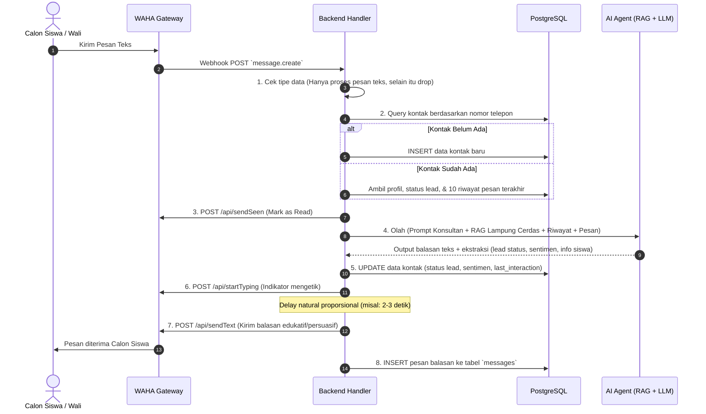

# Product Requirement Document (PRD)
## WhatsApp AI Sales & CS Agent - Program Lampung Cerdas

---

## 1. Document Overview
* **Product Name:** WhatsApp AI Sales & Consultation Agent (Lampung Cerdas)
* **Document Owner:** Tim Produk & Engineering Lampung Cerdas
* **Target Audience:** Internal Sales/CS Edukasi, Marketing Operations, & Development Team
* **Status:** Draft / Approved for Implementation
* **Version:** 1.1.0

---

## 2. Problem Statement & Objectives

### 2.1 Background & Pain Points (Kasus Lampung Cerdas)
1. **Lonjakan Chat Calon Peserta & Orang Tua:** Pada musim penerimaan mahasiswa baru (SNBP, SNBT, Ujian Mandiri, Kedinasan), ribuan pesan masuk menanyakan program bimbingan, beasiswa, dan konsultasi jurusan.
2. **Keterlambatan Respon (Lead Drop-off):** Siswa SMA/SMK dan orang tua membutuhkan respon cepat. Respon manual yang lambat menyebabkan calon peserta memilih lembaga bimbel lain.
3. **Follow-up Tidak Efektif:** Follow-up broadcast manual sering kali tidak relevan dengan minat kampus/jurusan yang sebelumnya ditanyakan calon siswa.
4. **Beban FAQ Berulang:** CS menghabiskan 80% waktu menjawab hal dasar (biaya program, jadwal bimbingan, fasilitas, garansi kelulusan) daripada melakukan konsultasi mendalam untuk *closing*.

### 2.2 Product Goals & KPIs
* **Lead Response Time:** Respon chat otomatis via AI dalam waktu < 5-8 detik (lengkap dengan indikator *seen* dan *typing* natural).
* **Closing & Conversion Rate:** Meningkatkan konversi prospek siswa/orang tua (*Warm/Hot ke Pendaftaran Program*) minimal 25-35% melalui follow-up terpersonalisasi.
* **Operational Efficiency:** Mengotomatiskan 70-80% penanganan pertanyaan FAQ program Lampung Cerdas.

---

## 3. Core Bot Processing Flow (Spesifikasi Alur Webhook ke Pengiriman)

Sistem bot merespons pesan masuk melalui pipeline berurutan sebagai berikut:

```
[ Webhook Masuk (WAHA) ]
           │
           ▼
[ 1. Cek Jenis Pesan ] ──(Bukan Teks/Media)──► [ Abaikan / Return 200 OK ]
           │ (Pesan Teks)
           ▼
[ 2. Cek Data Kontak di DB ]
     ├─ Belum Ada ──► Tambah Kontak Baru (No. WA, Waktu Masuk)
     └─ Sudah Ada  ──► Ambil Profil Kontak, Status Lead & Riwayat Chat
           │
           ▼
[ 3. Panggil API WAHA: sendSeen ] ──► (Tanda centang biru / pesan terbaca)
           │
           ▼
[ 4. Pemrosesan AI AGENT ]
     ├─ LLM + System Prompt (Persona Konsultan Edukasi Lampung Cerdas)
     ├─ RAG Product Knowledge (Paket Bimbel, Biaya, Jadwal, SOP Beasiswa)
     └─ Output: Draf Balasan + Ekstraksi Metadata (Nama, Asal Sekolah, Status Lead)
           │
           ▼
[ 5. Update Data Kontak di DB ] ──► (Update Status Lead, Sentimen, Profil Siswa)
           │
           ▼
[ 6. Panggil API WAHA: startTyping ] ──► (Simulasi sedang mengetik 2-4 detik)
           │
           ▼
[ 7. Panggil API WAHA: sendText ] ──► (Kirim balasan ke WhatsApp Siswa)
           │
           ▼
[ 8. Simpan Pesan Outbound ke Database ]
```

---

## 4. System Architecture & Technical Specifications

```
  +-------------------------------------------------------------+
  |              CALON SISWA / ORANG TUA (WhatsApp)             |
  +------------------------------+------------------------------+
                                 | (Pesan WhatsApp)
                                 v
  +-------------------------------------------------------------+
  |              WAHA Gateway (WhatsApp HTTP API)               |
  |  - /api/sendSeen    - /api/startTyping    - /api/sendText   |
  +------------------------------+------------------------------+
                                 | (Webhook: message.create)
                                 v
  +-------------------------------------------------------------+
  |               BACKEND SERVICE (Next.js / Node)              |
  |  - Webhook Filter & Validator  - Contact Sync Engine        |
  |  - State & Routing Controller  - Anti-Ban Queue & Jitter    |
  +--------------+---------------+--------------+---------------+
                 |                              |
                 v                              v
  +------------------------------+  +---------------------------+
  |      DATABASE & STORAGE      |  |     AI AGENT ENGINE       |
  |  - PostgreSQL (Supabase)     |  |  - OpenAI Compatible LLM  |
  |  - Vector Store (pgvector)   |  |  - Persona Lampung Cerdas |
  |  - Redis (BullMQ Queue)      |  |  - RAG Program Knowledge  |
  +------------------------------+  +---------------------------+
```

### 4.1 Integrations
* **WhatsApp Gateway:** WAHA (WhatsApp HTTP API) berbasis session QR Code multi-device.
* **LLM Engine (BYOK):** Mendukung provider OpenAI-compatible (OpenAI GPT-4o-mini, Groq Llama 3, DeepSeek, OpenRouter) dengan configurable `Base URL` & `API Key`.
* **Vector Store / RAG:** `pgvector` / Supabase Vector untuk *knowledge base* materi program Lampung Cerdas.
* **Message Queue & Task Scheduler:** Redis + BullMQ untuk eksekusi follow-up otomatis dan pengaturan delay natural (*anti-ban jitter*).

---

## 5. Sequence Diagram Alur Chat Bot



---

## 6. User Personas & Permissions

| Role | Scope Akses | Tanggung Jawab Utama |
|---|---|---|
| **Admin / Tech Lead** | Full Access | Manajemen sesi WAHA, konfigurasi BYOK LLM, enkripsi API key, monitoring server. |
| **Lead CS / Sales Manager** | Operational & Analytics | Konfigurasi Knowledge Base program (materi SNBP/SNBT, harga paket), setup jadwal follow-up, evaluasi konversi. |
| **CS / Konsultan Edukasi (Staff)** | Live Chat & Inbox | Monitoring live chat siswa, mengambil alih chat (*Takeover*), konsultasi privat, update pendaftaran. |

---

## 7. Functional Requirements & User Stories

### 7.1 WhatsApp Session Management (WAHA)
* **US-01:** Sebagai admin, saya ingin menyambungkan nomor WhatsApp CS Lampung Cerdas via Scan QR di dashboard.
* **Acceptance Criteria (AC):**
  * Tampilan QR Code interaktif dengan auto-refresh saat sesi aktif.
  * Status koneksi real-time: `DISCONNECTED`, `SCAN_QR`, `CONNECTED`.
  * Tombol aksi: *Restart Session*, *Logout / Disconnect*.

---

### 7.2 AI Agent Configuration & Knowledge Base (Program Lampung Cerdas)
* **US-02:** Sebagai CS Lead, saya ingin mengatur persona AI dan mengunggah materi program Lampung Cerdas agar AI menjawab akurat dan ramah.
* **Acceptance Criteria (AC):**
  * **System Persona:** Gaya komunikasi ramah, suportif, santun (*Kakak Konsultan Edukasi Lampung Cerdas*).
  * **Knowledge Base Upload:**
    * Upload dokumen (PDF/DOCX/TXT) berisi rincian paket bimbel (Garansi PTN, Kedinasan, Beasiswa, Bimbel Online/Offline).
    * Input manual tabel FAQ (Biaya cicilan, diskon pendaftaran, jadwal try out, testimoni kelulusan).
    * Auto-chunking & embedding ke vector store.
  * Parameter anti-halusinasi: `Similarity Threshold` agar AI tidak mengarang info harga/program yang tidak ada di dokumen.

---

### 7.3 Human Takeover & Live Chat Dashboard
* **US-03:** Sebagai konsultan manusia, saya ingin mengambil alih chat (*Takeover*) saat siswa ingin negosiasi biaya khusus atau meminta konsultasi mendalam.
* **Acceptance Criteria (AC):**
  * Status kontrol per kontak: `AI_HANDLED` atau `MANUAL_TAKEOVER`.
  * Jika `MANUAL_TAKEOVER`, webhook pesan masuk tidak akan diproses oleh AI.
  * Tombol switch instan *Takeover Chat / Return to AI* di antarmuka chat.
  * Notifikasi prioritas jika terdeteksi intent komplain atau *Hot Lead* siap transfer.

---

### 7.4 Follow-Up Terjadwal & Anti-Ban Safety (Edu-Sales Sequence)
* **US-04:** Sebagai tim sales, saya ingin mengirimkan follow-up terjadwal kepada siswa yang belum menyelesaikan pendaftaran.
* **Acceptance Criteria (AC):**
  * **Lead Stages:** *Cold* (Baru tanya), *Warm* (Tanya harga/fasilitas), *Hot* (Minta no. rekening/form pendaftaran), *Pending Payment*, *Enrolled (Closed Won)*, *Lost*.
  * **Trigger Inactivity:** Otomatis memicu pesan follow-up setelah X jam tanpa balasan (misal: H+1 setelah tanya paket bimbel).
  * **AI Contextual Copywriting:** Pesan disusun unik berbasis histori (misal: *"Halo Kak Budi, kemarin sempat tanya paket Kedinasan IPDN ya? Kebetulan kuota bimbingan sisa 3 slot lagi..."*).
  * **Anti-Ban Guardrails:**
    * Random Delay (*Jitter*): 15 - 45 detik antar pengiriman pesan follow-up.
    * Limit Kuota: Maks 30 pesan/jam per nomor CS.
    * Auto Opt-Out jika siswa membalas *"Stop"*, *"Tidak berminat"*, atau kata kunci penolakan.

---

### 7.5 Analytics & Conversion Funnel Dashboard
* **US-05:** Sebagai manajer, saya ingin memantau performa closing dan pertanyaan paling populer seputar program Lampung Cerdas.
* **Acceptance Criteria (AC):**
  * Funnel pendaftaran: Chat Masuk -> Tanya Program -> Diberikan Form -> Pembayaran/Enrolled.
  * Statistik program paling diminati (SNBT vs Kedinasan vs Mandiri).
  * Metrik kecepatan respon AI vs Agen Manual.
  * Analisis sentimen siswa/orang tua (*Positive, Neutral, Negative*).

---

## 8. Database Schema Design (PostgreSQL / Supabase)

```sql
-- Tabel Sesi WhatsApp WAHA
CREATE TABLE wa_sessions (
    id VARCHAR(50) PRIMARY KEY,
    session_name VARCHAR(100) NOT NULL,
    status VARCHAR(30) DEFAULT 'DISCONNECTED', -- SCAN_QR, CONNECTED, DISCONNECTED
    qr_code_raw TEXT,
    created_at TIMESTAMP WITH TIME ZONE DEFAULT NOW(),
    updated_at TIMESTAMP WITH TIME ZONE DEFAULT NOW()
);

-- Tabel Kontak / Calon Siswa (Lead Lampung Cerdas)
CREATE TABLE contacts (
    id BIGSERIAL PRIMARY KEY,
    phone_number VARCHAR(30) UNIQUE NOT NULL,
    customer_name VARCHAR(150),
    school_origin VARCHAR(150), -- Asal Sekolah (SMA/SMK/Alumni)
    target_campus_major VARCHAR(200), -- Target Kampus/Jurusan/Kedinasan
    lead_status VARCHAR(50) DEFAULT 'Cold', -- Cold, Warm, Hot, Pending_Payment, Enrolled, Lost
    handling_status VARCHAR(30) DEFAULT 'AI_HANDLED', -- AI_HANDLED, MANUAL_TAKEOVER
    sentiment VARCHAR(30) DEFAULT 'Neutral', -- Positive, Neutral, Negative
    last_customer_message_at TIMESTAMP WITH TIME ZONE,
    last_interaction_at TIMESTAMP WITH TIME ZONE DEFAULT NOW(),
    created_at TIMESTAMP WITH TIME ZONE DEFAULT NOW()
);

-- Tabel Riwayat Pesan Chat
CREATE TABLE messages (
    id BIGSERIAL PRIMARY KEY,
    contact_id BIGINT REFERENCES contacts(id) ON DELETE CASCADE,
    waha_message_id VARCHAR(100) UNIQUE, -- Idempotency / Deduplikasi pesan WAHA
    sender_type VARCHAR(20) NOT NULL, -- 'customer', 'ai', 'agent'
    message_body TEXT NOT NULL,
    is_follow_up BOOLEAN DEFAULT FALSE,
    created_at TIMESTAMP WITH TIME ZONE DEFAULT NOW()
);

-- Tabel Aturan Follow Up Edukasi
CREATE TABLE follow_up_rules (
    id BIGSERIAL PRIMARY KEY,
    rule_name VARCHAR(100) NOT NULL,
    target_lead_status VARCHAR(50) NOT NULL,
    inactivity_hours INT NOT NULL,
    ai_prompt_instruction TEXT NOT NULL,
    is_active BOOLEAN DEFAULT TRUE,
    created_at TIMESTAMP WITH TIME ZONE DEFAULT NOW()
);

-- Tabel Konfigurasi AI & Persona
CREATE TABLE ai_configurations (
    id SERIAL PRIMARY KEY,
    provider_base_url VARCHAR(255) NOT NULL,
    api_key_encrypted TEXT NOT NULL,
    model_name VARCHAR(100) NOT NULL,
    temperature NUMERIC(3,2) DEFAULT 0.6,
    max_tokens INT DEFAULT 600,
    system_prompt TEXT NOT NULL,
    created_at TIMESTAMP WITH TIME ZONE DEFAULT NOW()
);

-- Tabel Dokumen Knowledge Base (RAG)
CREATE TABLE knowledge_documents (
    id BIGSERIAL PRIMARY KEY,
    title VARCHAR(200) NOT NULL,
    category VARCHAR(50) DEFAULT 'General', -- Paket_Bimbel, Biaya, FAQ, Beasiswa
    content TEXT NOT NULL,
    created_at TIMESTAMP WITH TIME ZONE DEFAULT NOW()
);
```

---

## 9. Non-Functional Requirements (NFR)

* **Latency:** Respon total (RAG Search + LLM + Jeda Mengetik) maksimal 4-7 detik.
* **Idempotency:** Webhook WAHA harus memvalidasi `waha_message_id` untuk mencegah pesan dibalas dua kali (*anti-double reply*).
* **Security:** API Key LLM wajib dienkripsi di level basis data (`AES-256`).
* **Availability:** Arsitektur stateless dengan Redis queue memastikan pesan tidak hilang saat lonjakan traffic (*peak season* pendaftaran).

---

## 10. Release Milestones & MVP Scope

| Milestone | Ruang Lingkup Fitur | Estimasi |
|---|---|---|
| **Phase 1 (MVP - Bot Konsultan Dasar)** | • Setup WAHA (Scan QR & Webhook handler)<br>• Pipeline Lengkap: Filter teks -> Kontak -> Send Seen -> AI Agent -> Update DB -> Typing -> Send Text<br>• Knowledge Base dasar Program Lampung Cerdas (FAQ & Biaya)<br>• Live Chat Inbox & Human Takeover Toggle | Sprint 1-2 |
| **Phase 2 (Automation & Follow-Up)** | • Segmented Auto Follow-up (Trigger Inactivity berdasarkan status *Warm/Hot*)<br>• Anti-ban Jitter Delay & Rate Limiter Queue<br>• Upload Dokumen RAG (PDF Silabus & Brosur Program) | Sprint 3-4 |
| **Phase 3 (CRM Analytics & Auto-Labeling)** | • Dashboard Funnel Konversi Siswa (Tanya -> Daftar -> Lunas)<br>• Auto-ekstraksi asal sekolah & target kampus via AI Structured Output<br>• Sentiment & Escalation Alert | Sprint 5 |